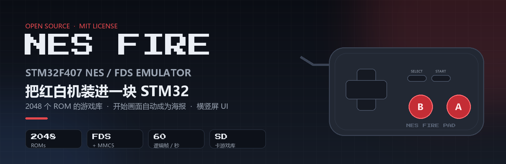
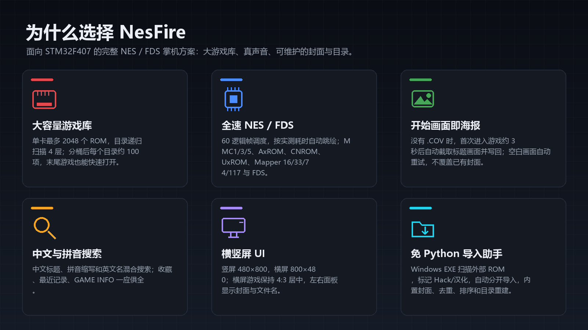
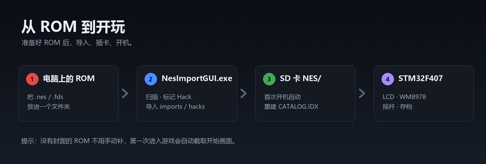
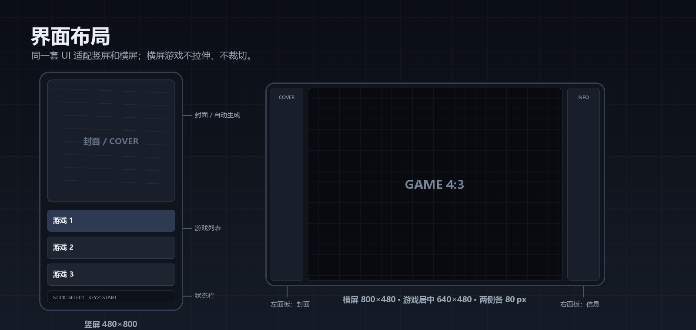
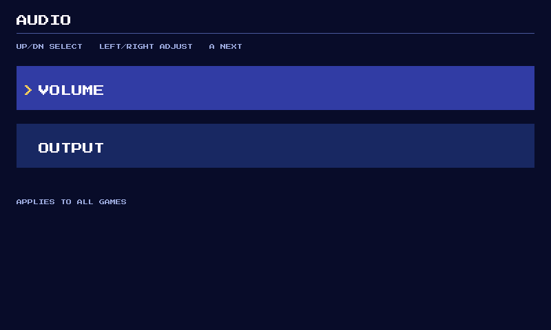
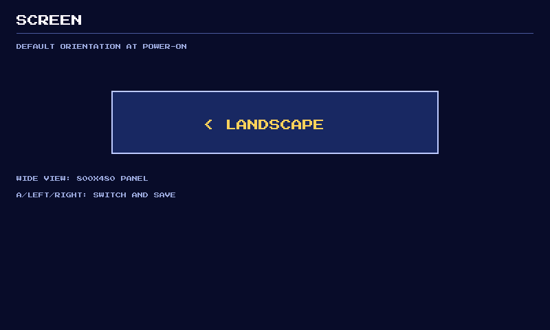
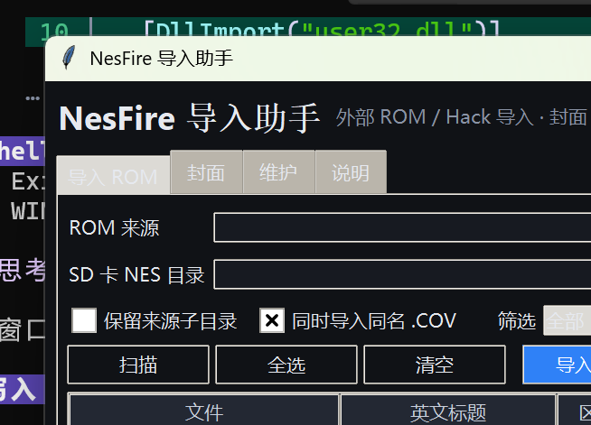

  

<h1 align="center">NES Fire Emulator</h1>

  <b>把红白机装进一块 STM32F407。</b> 
  SD 卡游戏库 · 最多 2048 个 ROM · FDS / MMC5 · 横竖屏 UI · 开始画面自动成为海报

  
  
  
  

> 一台能装进口袋的 NES：插卡即玩，封面自动生成，上千个 ROM 也能快速找到。

## 这是什么

NesFire 是一个运行在 **野火 STM32F407ZGT6 霸天虎 V2** 上的 NES / Famicom Disk System 模拟器。
它不只是“能跑 ROM”的固件：游戏库、封面、搜索、收藏、存档、横竖屏 UI 和音频输出，
都被做成了一个可以直接上手的掌机系统。

- **两千级游戏库**：单卡最多 2048 个 ROM，递归扫描 4 层；已实测 1550 个 ROM + 1550 个封面。
- **全速调度**：60 逻辑帧/秒，按实测耗时自动跳绘，优先保证游戏速度。
- **声音认真**：WM8978 扬声器/耳机/静音，APU + FDS + MMC5 音源。
- **画面认真**：竖屏 480×800，横屏 800×480；横屏游戏 4:3 居中，两侧信息面板。
- **封面不用愁**：没有 `.COV` 时，第一次进入游戏约 3 秒后自动截取开始画面。
- **普通人也能维护**：免 Python 的 Windows 导入助手，扫描、标记 Hack、导入、去重、排序。

## 适合谁

- **复古玩家**：插卡即玩，封面、收藏、搜索、存档齐全，不用折腾命令行。
- **硬件玩家**：野火 F407 + 480×800 屏 + WM8978，接线、按键和外壳位置都有文档。
- **嵌入式学习者**：从 6502 / PPU / APU 到 FatFs、SDIO、DMA 音频的一套完整工程。

## 亮点一览

## 三步开始

1. **准备 ROM**：把 `.nes` / `.fds` 放进电脑上的一个文件夹。
2. **导入 SD 卡**：从 [Releases](https://github.com/6baol/nes-fire-stm32f407/releases) 下载 `NesImportGUI.exe`，选择来源和 `X:\NES`，扫描后导入。
3. **上机开玩**：插卡上电；第一次开机自动重建目录，没有封面的游戏会在首玩后自动生成海报。

完整步骤（烧录、接线、按键、常见问题）见 **[新手教程 TUTORIAL.md](TUTORIAL.md)**。

## 核心能力

### 游戏库：为“大”而生

- **2048 个 ROM 的目录**：`NES/CATALOG.IDX` 常驻 SD 卡，RAM 只保留窗口，不占住内存。
- **递归扫描 4 层**：`NES/`、`NES/imports/`、`NES/hacks/`、`NES/famicom/00/` 都能识别。
- **分桶加速**：`tools/bucket_sd.py` 每 100 个一组；路径查找从上千项降到约 100 项。
- **8 MHz SDIO + 多块读**：封面和 ROM 读取更快，末尾条目也不拖沓。
- **中文 / 拼音 / 英文搜索**：`bian`、`bianfuxia`、`bfx` 都能命中“蝙蝠侠”。
- **收藏、最近、GAME INFO**：常用游戏不用每次翻列表。

### 画面：竖屏和横屏都认真做

- 竖屏 **480×800**：上半区封面，下半区三行滚动列表，底部状态栏。
- 横屏 **800×480**：游戏保持 **640×480 居中 4:3**，不拉伸、不裁切；左右各 80 px 面板显示封面缩略图和文件名。
- **自适应绘制**：根据实测绘制/跳绘耗时调整间隔，逻辑帧仍然按 60 Hz 推进。

  
  

### 声音：不是“能响就行”

- WM8978 编解码器，I2S2：扬声器、耳机、静音三种输出。
- NES APU + FDS 波表/包络/调制 + MMC5 音频。
- **PC6 固定为 I2S2_MCLK**；硬件 A 键使用 **PE3**，不要把按键接回 PC6。

### 存档、收藏与设置

- 电池 SRAM 双槽存档，CRC 校验；退出游戏时写入 `NES/SAVES/`。
- `PREFS0/1.DAT` 保存收藏和最近记录；去重/分桶会自动重映射路径键。
- `SETTINGS.BIN` 保存横竖屏、音量、输出。
- 游戏运行期间不访问 SD（存档除外），避免拖慢帧率。

### 外部 ROM、Hack 与封面

- Windows 导入助手：扫描来源、标记 Hack/汉化、复制到 `NES/imports` 或 `NES/hacks`，同名不覆盖。
- 去重只按英文标题保留一个版本；**Hack、汉化、Beta、Proto、Bootleg、`[h]`、`hacks/` 永远不参与**。
- 目录重建后可按英文名排序、填充拼音。
- 没有 `.COV` 的 ROM：首玩约 3 秒（FDS 约 6 秒）自动截取开始画面，空白画面自动重试。

  

> 导入助手的下载和详细说明见 [Doc/external_roms.md](Doc/external_roms.md)。

### 兼容性

| 类别 | 支持 |
|---|---|
| NES mapper | 0, 1, 2, 3, 4, 5 (MMC5), 7 (AxROM), 11, 16, 33, 40, 66, 71, 74, 117 |
| FDS | Mapper 20；换面、FDS 音源；只读磁盘 |
| 存档 | 带 battery 标志卡带的 8 KiB SRAM，双槽 + CRC |
| 未实现 | MMC2/4、VRC、Namco、Sunsoft 等；PAL/VS/PlayChoice；即时存档、FDS 写盘、双人 |

> 同 mapper 不保证所有游戏兼容。完整列表和限制见 [Doc/mapper_support.md](Doc/mapper_support.md)。

### 性能：大库也跟手

- 目录常驻 SD 卡，RAM 只保留窗口；分桶后每个目录约 100 项。
- 8 MHz SDIO + 多块读，封面和 ROM 打开更快，列表末尾也不拖沓。
- 60 逻辑帧调度 + 自适应跳绘，优先保证游戏速度。
- 已用 **1550 个 ROM + 1550 个封面**的真实库验证。

### 硬件

| 项目 | 配置 |
|---|---|
| 开发板 | 野火 STM32F407ZGT6 霸天虎 V2 |
| 屏幕 | 480×800 MCU LCD |
| 音频 | WM8978，扬声器 / 3.5 mm 耳机 |
| 输入 | 摇杆、KEY1、KEY2、SW、电容键；扩展 A=PE3 |
| 存储 | SD 卡 FAT32；`NES/SAVES/` 存档 |

### 文档

| 文档 | 内容 |
|---|---|
| [TUTORIAL.md](TUTORIAL.md) | 从烧录到开玩的完整教程 |
| [Doc/external_roms.md](Doc/external_roms.md) | 导入助手、Hack、封面与目录维护 |
| [Doc/mapper_support.md](Doc/mapper_support.md) | Mapper 支持范围与限制 |
| [Doc/sd_bucketing.md](Doc/sd_bucketing.md) | 大目录分桶与封面来源 |
| [Doc/settings_centre.md](Doc/settings_centre.md) | 设置中心与横竖屏 |
| [Doc/library_details.md](Doc/library_details.md) | 游戏库、搜索与详情页 |

## 许可与素材

代码以 **MIT** 许可发布。ROM、FDS BIOS、封面和字模不属于代码许可范围；
请只使用你自己合法拥有的文件。仓库不提供成品固件镜像，构建步骤见
[TUTORIAL.md](TUTORIAL.md)。
